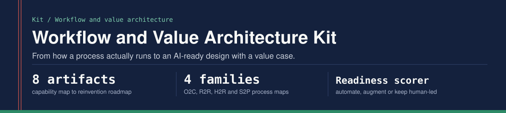

<p align="center"></p>

The working set I use to take a process from "how it actually runs" to an AI-ready, build-ready design with a value case attached. It pairs with [agentic-enterprise-workflows](https://github.com/prateek-ratnakar/agentic-enterprise-workflows), which runs three of these designs as a working prototype.

| # | Artifact | Question it answers |
|---|---|---|
| 1 | [Business capability map](01-business-capability-map.md) | What does the enterprise need to be able to do, independent of org chart and systems? |
| 2 | [Value chain analysis](02-value-chain-analysis.md) | Where is value created or leaked, and where would AI move the number? |
| 3 | [Process families](process-families/) - O2C, R2R, H2R, S2P | What are the steps, handoffs, exceptions and KPIs in each end-to-end workflow? |
| 4 | [AI-readiness scoring](ai-readiness/) | Which steps should an agent act on, which should it prepare for a person, and which stay human-led? |
| 5 | [Agentic solution design canvas](05-agentic-solution-design-canvas.md) | Agent roles, prompt logic, RAG grounding, orchestration, guardrails, human-in-the-loop, token cost |
| 6 | [AI governance controls](06-ai-governance-controls.md) | What has to be true before an AI system reaches users, and how is it rolled back? |
| 7 | [Value realization](07-value-realization.md) | Baseline, KPI tree, business case, benefits tracking |
| 8 | [Reinvention roadmap](08-reinvention-roadmap.md) | How to sequence redesign, automation and agentic adoption across towers against the business case |

## Where this comes from

Sections 5 to 8 codify how I founded and ran a GenAI and Agentic AI program in a 2,500-person trust and risk operation: exit criteria before build, UAT against human decisions, cohort rollout with a tested rollback path, and value tracked against a baseline. Sections 1 to 3 are reference structures for the standard enterprise process families, built in the style of public process-classification frameworks. They are study and design aids, not client deliverables, and contain no employer or client data.

## How this was built

I set the brief and the release standards, and Claude, an AI assistant, drafted the reference structures with me and wrote the scorer code. I work at the design, requirements and evaluation layer, and I do not write or review application code.

## Run the scorer

```bash
python ai-readiness/scorer.py ai-readiness/sample_steps.csv
python -m unittest discover -s tests -v
```

Prateek Ratnakar | [prateek-ratnakar.github.io](https://prateek-ratnakar.github.io) | [LinkedIn](https://www.linkedin.com/in/prateekratnakar)
